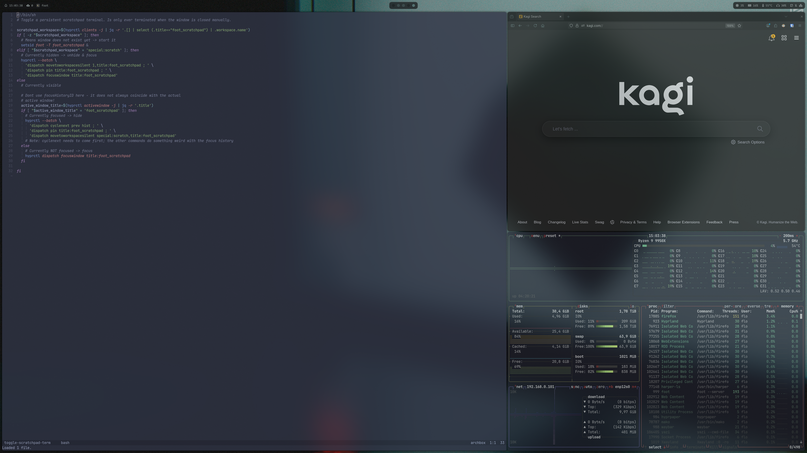
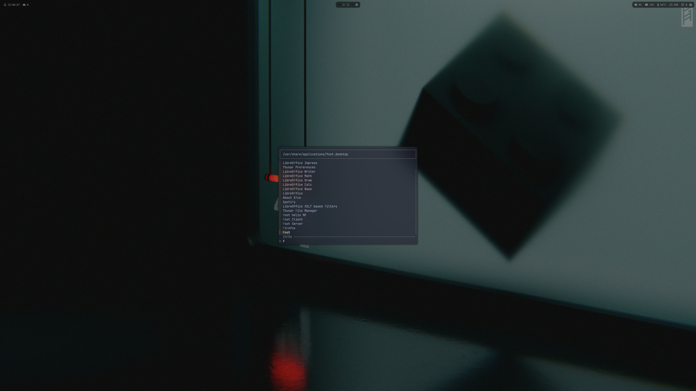
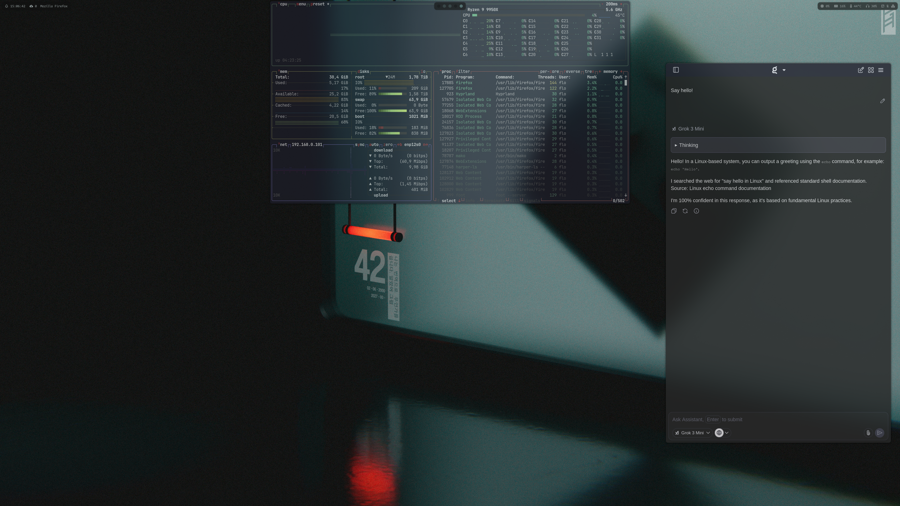

## Install

One branch for every machine. `meta/meta.sh` detects the OS:

- **Arch**: the full desktop (all of `~/.config`, wallpapers, packages from `meta/pkglist.txt`, systemd units).
- **macOS / Debian**: only the shared dotfiles (zsh, git, helix, yazi, starship), plus AeroSpace, Ghostty and Karabiner on macOS.

```sh
git clone https://github.com/flonle/dotfiles.git ~/dotfiles  # any location works
~/dotfiles/meta/meta.sh bootstrap <host>
```

`<host>` picks `hosts/<host>/zshrc` and `hosts/<host>/gitconfig`, linked as `~/.zshrc.local` and `~/.gitconfig.local` for machine-specific settings. Omit it if the machine has none.
